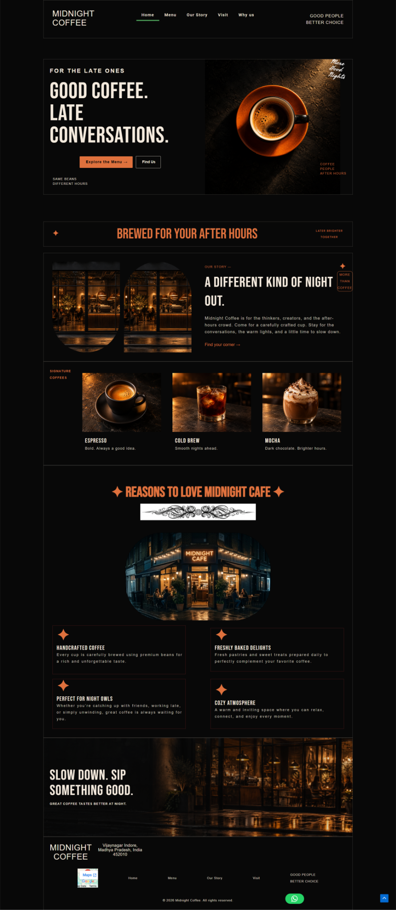
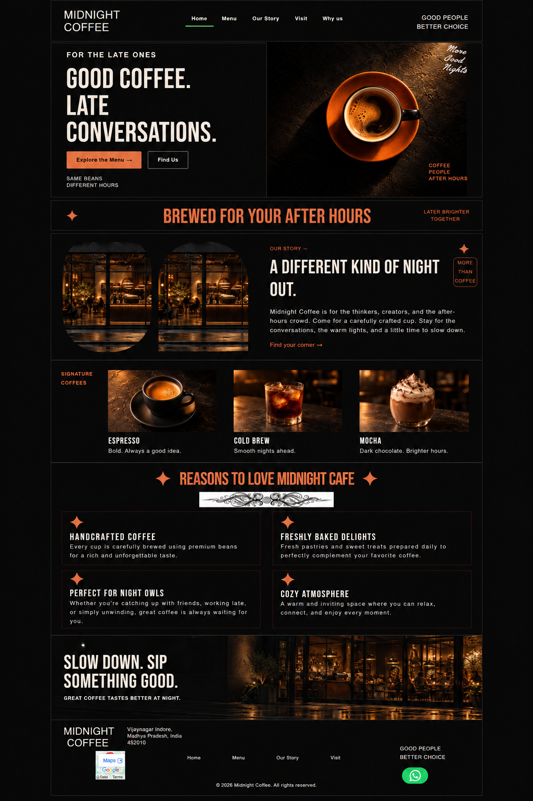
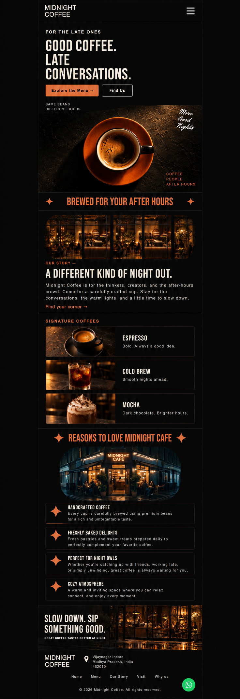

# Midnight Coffee

A cafe website built around an after-hours coffee experience, using dark
surfaces, orange accents and warm photography to tell the brand story.

## Technology

WordPress, Elementor Pro and Astra, using an Atomic Elementor page-building
workflow.

## My contribution

Atul Tiwari: Elementor page composition, visual styling, image placement,
brand presentation and responsive layout configuration.

## Project features

- A prominent hero with menu and location calls to action.
- Cafe story and signature-drink presentation.
- Benefits and reasons-to-visit sections.
- Location, contact and visit information.
- Desktop, tablet and mobile layout arrangements.

## Preview gallery

| Desktop preview | Tablet mockup | Mobile mockup |
| --- | --- | --- |
|  |  |  |

## Current status

Screenshot showcase of a locally built Elementor website. Tablet and mobile
images are supplied layout mockups. A live demo URL will be added after hosting
and functional verification.

[Back to project showcase](../../README.md)
