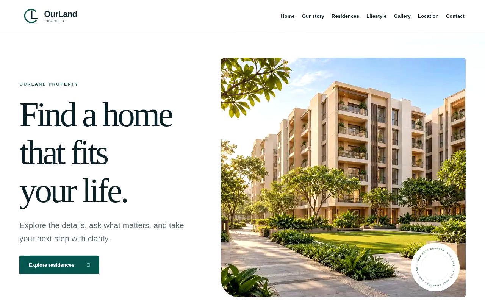

# OurLand Property — Guided WordPress Project

A guided custom WordPress project in progress, using a property website to
practise local setup, theme/plugin integration and site configuration.
The implementation lets visitors explore homes, view property information and
make enquiries, with a separate workspace for property content and leads.

## Technology

WordPress, PHP, JavaScript, HTML and CSS, using a custom theme and project
plugins.

## My contribution

Atul Tiwari:

- Set up the project in LocalWP and integrated supplied custom theme/plugin files.
- Followed guided steps to configure pages, property content and the client workspace.

## Implementation features

- Seven editable pages covering the brand, residences, lifestyle and contact.
- Property listing and detail templates with shared image and text styles.
- Property information and photo management through WordPress.
- A lead/CRM workspace with separate client and developer permissions.
- Reusable animation effects with editor controls and responsive fallbacks.

## Implementation preview

### Latest Preview — video

**[Watch / download OurLand Property — Latest Preview](videos/ourland-property-latest-preview.mp4)**

Recorded on 27 October 2026 from an isolated WordPress installation using the
current project source. The edited tour shows the seven public pages, a concept
property photo gallery, scroll-driven animation and a 390px mobile viewport.
This is a guided implementation preview with illustrative property concepts;
it is not a production listing or an independently authored-plugin claim.

MP4 · 66 seconds · 1280 × 720 · approximately 12.1 MB. Open the linked file and
use **Download raw file** to save a local copy for the Fiverr gallery. The video
has original synthesized background audio and no external links/contact details.
Fiverr upload acceptance remains subject to its current review process.

### Homepage screenshot

This image is captured from a recorded implementation preview with illustrative
property content. It is a presentation of the local build rather than a live
production URL.

## Current status

The guided project is in progress. Learning PHP/JavaScript foundations and
WordPress theme/plugin structure, reviewing the code and making independent
changes are ongoing learning goals. Production deployment and final
business-flow acceptance also remain in progress. A live demo URL will be added
after deployment and verification.

[Back to project showcase](../../README.md)
