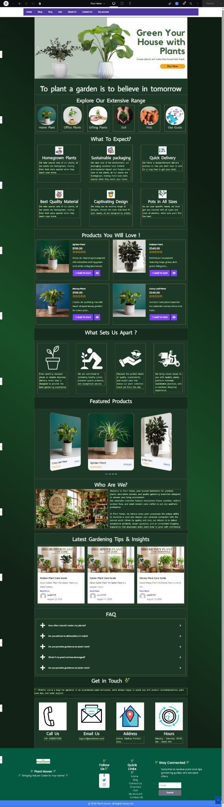
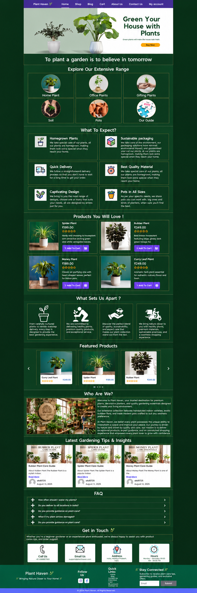
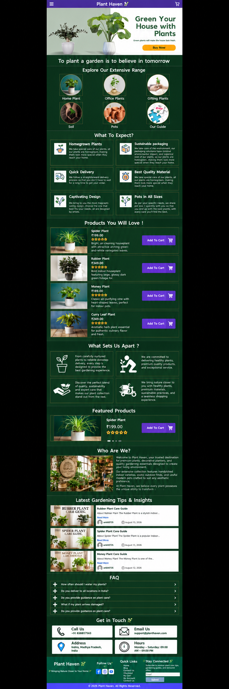

# Plant Haven

A plant-storefront interface that brings product discovery, gardening imagery
and plant-care content into one WordPress website.

## Technology

WordPress and Atomic Elementor.

## My contribution

Atul Tiwari: visual page building, section composition, product and article
presentation, image placement and responsive layout configuration in Elementor.

## Project features

- Plant-focused hero and category navigation.
- Product cards showing imagery, prices and cart controls.
- Featured-product presentation and gardening article cards.
- Brand story, benefits, FAQs and contact information.
- Alternative category, product and article arrangements across the previews.

## Preview gallery

| Desktop preview | Tablet mockup | Mobile mockup |
| --- | --- | --- |
|  |  |  |

## Current status

Screenshot showcase of a locally built storefront. Tablet and mobile images
are supplied layout mockups. Cart/checkout and other interactive flows require
functional verification before a live commerce demo is listed.

[Back to project showcase](../../README.md)
