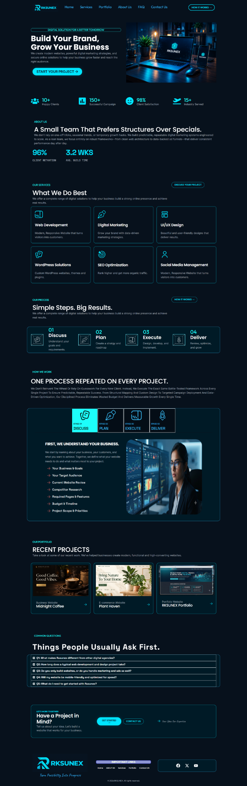
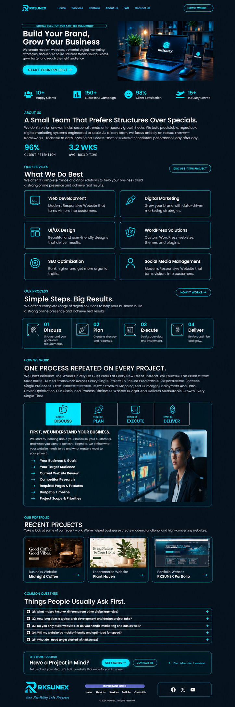
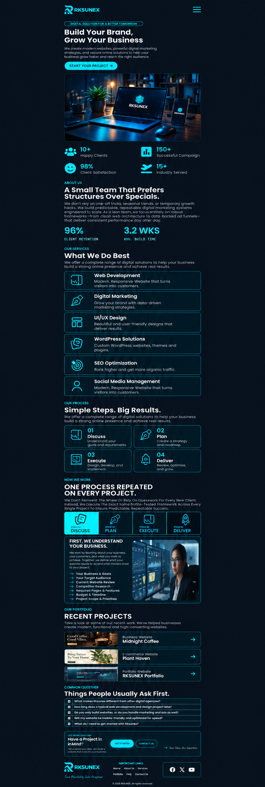

# RKSUNEX

A digital-services website using a navy and cyan visual identity to introduce
services, explain the delivery process and showcase selected website projects.

## Technology

WordPress and Atomic Elementor.

## My contribution

Atul Tiwari: Elementor page composition, visual styling, service and portfolio
layouts, image placement and responsive layout configuration.

## Project features

- Brand introduction and project-enquiry calls to action.
- A service-card grid covering web, design and marketing services.
- Process overview and detailed stage tabs.
- Project portfolio, frequently asked questions and contact sections.
- Desktop, tablet and mobile layout arrangements.

## Preview gallery

| Desktop preview | Tablet mockup | Mobile mockup |
| --- | --- | --- |
|  |  |  |

## Current status

Screenshot showcase of a locally built Elementor website. Tablet and mobile
images are supplied layout mockups. A live demo URL will be added after hosting
and functional verification.

[Back to project showcase](../../README.md)
